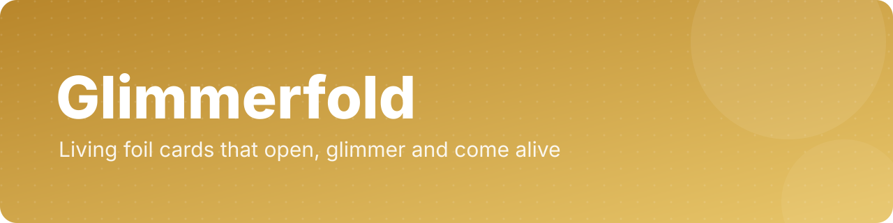
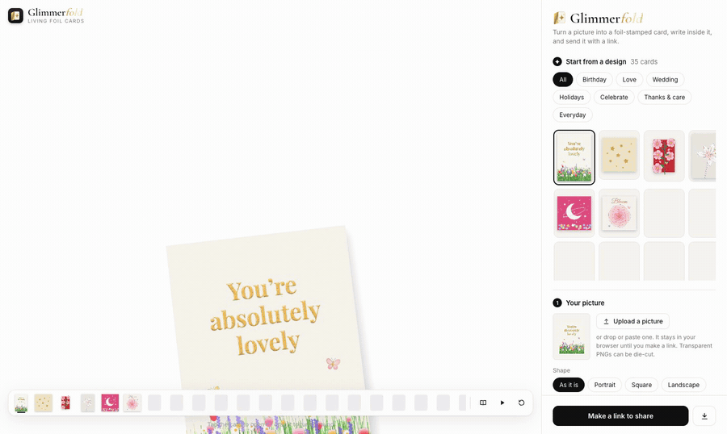
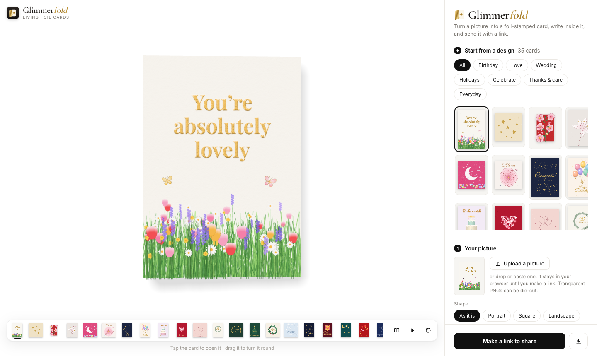
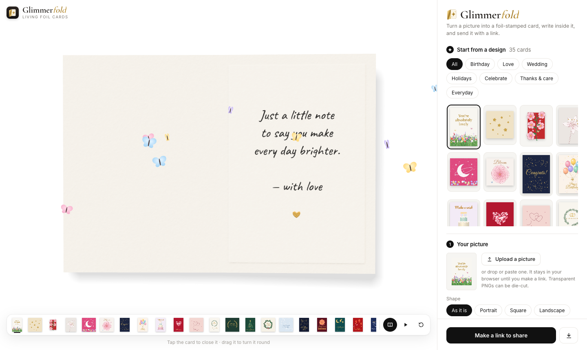
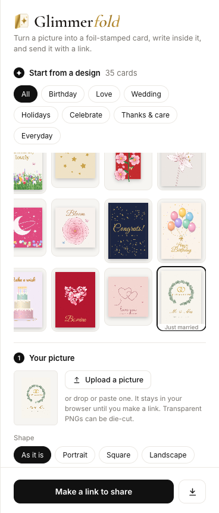
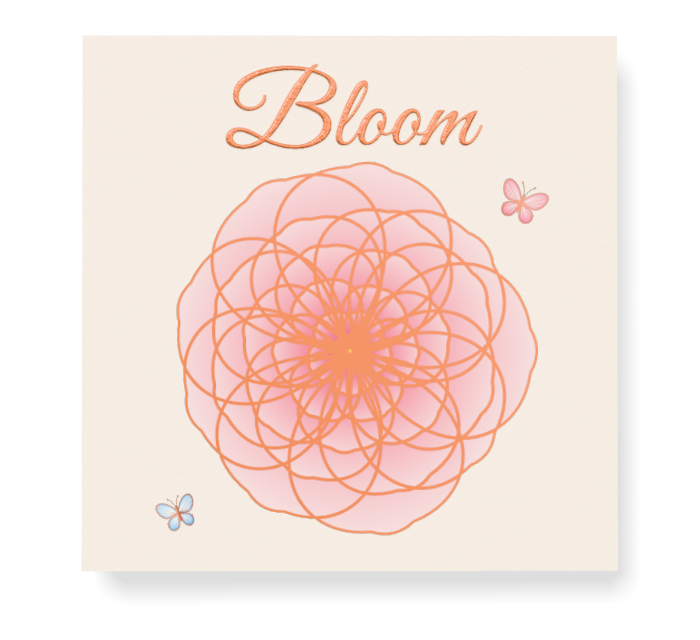
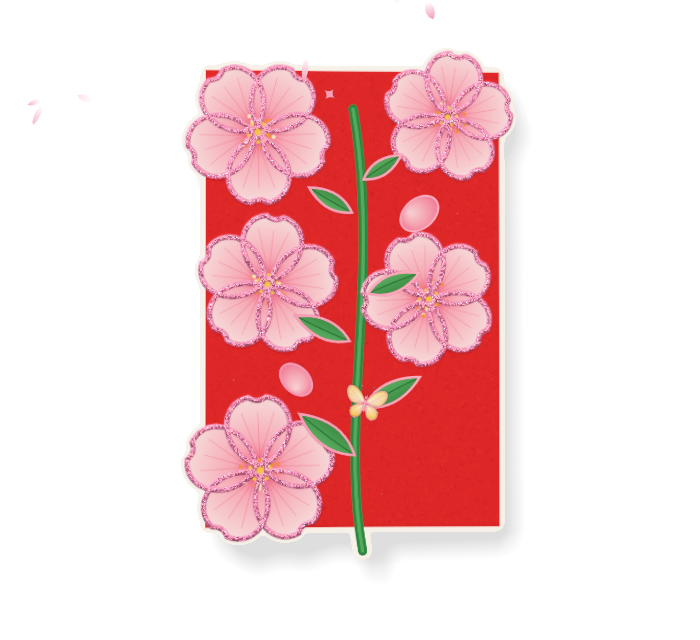
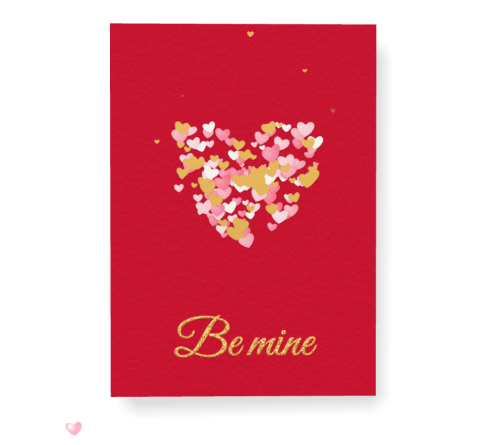
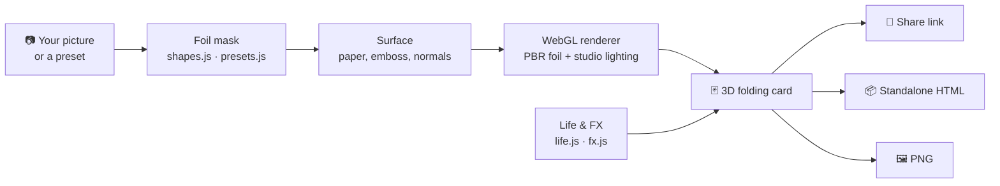

<div align="center">



<br />


### Turn any photo into a foil‑stamped greeting card that opens, glimmers and comes alive — right in the browser.

<p>
  
  
  
  
  
</p>

<a href="#-quick-start"><b>Quick start</b></a> ·
<a href="#-features"><b>Features</b></a> ·
<a href="#-gallery"><b>Gallery</b></a> ·
<a href="#-how-it-works"><b>How it works</b></a> ·
<a href="sample-cards/glimmerfold-happiness.html"><b>Sample card</b></a>

<br /><br />



<sub>▲ Real capture of the app — the foil catches the light as the card tilts, then it opens.</sub>

</div>

---

## ✨ Why Glimmerfold

- 🪙 **Real‑looking foil** — gold, silver, rose and copper rendered with physically based lighting, in mirror, satin, brushed or glitter finishes.
- 📖 **Cards that actually open** — a 3D fold with a handwritten note inside; drag to turn it round, tap to open.
- 🦋 **They come alive** — butterflies, confetti, snow, lanterns, fireworks and more drift around the card.
- 🖼️ **Your photo, your card** — upload, drop or paste any picture; transparent PNGs can even be die‑cut.
- 🔗 **Share in one click** — make a link, or download the card as a single HTML file that opens in any browser, even offline.
- 🔒 **Private by default** — your picture stays in your browser until *you* make a link.

## 🎬 See it in action

<div align="center">
  
</div>

<table>
  <tr>
    <td width="50%"></td>
    <td width="50%"></td>
  </tr>
  <tr>
    <td align="center"><b>Open it</b> — a handwritten note waits inside</td>
    <td align="center"><b>Make it yours</b> — designs, photo, shape, foil, paper</td>
  </tr>
</table>

> [!TIP]
> Want the full motion? Watch the [demo video (MP4)](assets/readme/demo.mp4).

## 🎨 Gallery

Start from one of **35 hand‑built designs** across Birthday, Love, Wedding, Holidays, Celebrate, Thanks & care and Everyday — every piece of artwork is drawn procedurally, with its own foil mask.

<table>
  <tr>
    <td align="center" width="25%"><br /><sub><b>Bloom</b></sub></td>
    <td align="center" width="25%"><br /><sub><b>Blossom</b></sub></td>
    <td align="center" width="25%"><br /><sub><b>Be mine</b></sub></td>
    <td align="center" width="25%"><br /><sub><b>Just married</b></sub></td>
  </tr>
</table>

## 🧰 Features

| | |
|:--|:--|
| **Foils** | Gold, silver, rose, copper — or any custom colour |
| **Finishes** | Mirror · Satin · Brushed · Glitter |
| **Paper** | Smooth · Cotton · Linen · Felt, in any colour, with adjustable emboss |
| **Shapes** | As it is · Portrait · Square · Landscape · Die‑cut |
| **Foil placement** | As designed · Fill all · Fill the front · Paint it with a brush |
| **Inside** | Write a letter in handwriting fonts; pressed impression or letterpress cover |
| **Life** | Butterflies, hearts, confetti, balloons, snow, petals, lanterns, bats, fireworks… |
| **Export** | Shareable link · standalone interactive `.html` card · PNG still |

## 🚀 Quick start

No dependencies, no build step — just a static site.

```bash
git clone https://github.com/Arxana04/glimmerfold.git
```

```bash
cd glimmerfold && python3 serve.py
```

Then open **http://localhost:5173** and drop in a picture. Pass a port to change it: `python3 serve.py 8080`.

<details>
<summary><b>Any other static server works too</b></summary>

```bash
npx serve .
```

`serve.py` just adds no‑cache headers so edits show up on refresh. Open the page over `http://` (not `file://`) because it uses ES modules.
</details>

<details>
<summary><b>Just want to see a card?</b></summary>

Open [`sample-cards/glimmerfold-happiness.html`](sample-cards/glimmerfold-happiness.html) in any browser — that's what a downloaded card looks like: one self‑contained file.
</details>

## 🧠 How it works



<details>
<summary><b>Project layout</b></summary>

```text
index.html            the app (editor + stage)
brand.html            brand sheet
serve.py              tiny no-cache dev server
js/
  main.js             state, WebGL renderer, UI wiring
  surface.js          paper textures and emboss
  shapes.js           vector shapes for foil artwork
  presets.js          procedural gallery artwork + foil masks
  occasions.js        the 35 designs and their settings
  life.js / fx.js     living sprites and particle effects
  livecat.js          animated cat sprite
  gallery.js          design gallery UI
  share.js            share links
  package.js          standalone card export
sample-cards/         an exported example card
assets/               logo, icon and README media
```
</details>

## 🗺️ Roadmap

- [x] 35 procedural designs with matching foil
- [x] Standalone, offline card export
- [x] Shareable links
- [ ] Your idea here — [open an issue](https://github.com/Arxana04/glimmerfold/issues)

## 🤝 Contributing

Contributions are welcome! Fork the repo, run `python3 serve.py`, make your change and open a pull request. New designs live in `js/occasions.js` and `js/presets.js`.

---

<div align="center">

Made with ✨ and a lot of gold leaf.

If Glimmerfold made you smile, **give it a ⭐** — it helps others find it.

<a href="#top">↑ Back to top</a>

</div>
